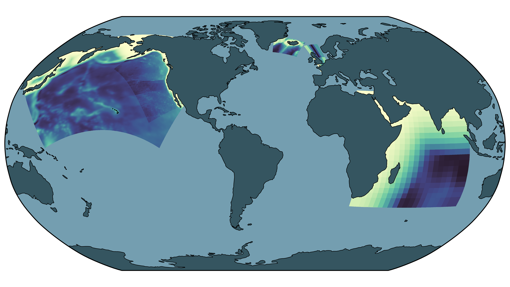

.. _forge-index:

Forge
=====

Forge is C-Star's application for creating new UCLA-ROMS domains. Setting up
a regional simulation has traditionally meant weeks of work: designing a grid,
collecting and regridding forcing datasets, hand-editing configuration files,
and hoping the result reproduces on the next machine. Forge automates that
path. You describe what you want (a region, a resolution, a time window,
forcing sources) in a :doc:`forge blueprint <blueprint>`, and Forge
produces everything the model needs to run, in a form C-Star can build and
execute anywhere.

How it works
------------

Forge has two sides separated by the blueprint.

**Authoring** happens in the :doc:`wizard <../../wizard/blueprints>`. It composes a forge
blueprint from :doc:`specs <specs>` in the :doc:`catalog <../../catalog>`, a
model configuration, a domain, a forcing selection and output settings, plus
your edits, and writes out the resolved values in full.

**Processing** happens when you run the blueprint with
``cstar blueprint run`` (or ``cstar forge run`` for the full option set). On
whatever machine you run it, Forge:

1. stages the :doc:`source datasets <source_datasets>` the blueprint needs,
   downloading what it can and checking for the files you must provide;
2. generates the input files with
   `ROMS-Tools <https://roms-tools.readthedocs.io>`__: the grid, initial
   conditions, surface and boundary forcing, and tides, rivers and carbon
   dioxide removal forcing where requested;
3. renders the model's compile-time switches (``cppdefs.opt``) and run-time
   namelist (``namelist.nml``) from the blueprint's settings;
4. writes a :doc:`UCLA-ROMS blueprint <../ucla_roms/blueprint>` that
   points at all of the above.

Running that UCLA-ROMS blueprint is a normal C-Star simulation; Forge is no
longer involved. The :doc:`end-to-end tutorial <../../tutorials/end_to_end>`
walks through the whole sequence on a toy domain.

The datasets Forge draws on include GLORYS ocean reanalysis, ERA5
atmospheric reanalysis, a unified biogeochemical climatology, SRTM15 and
ETOPO bathymetry, river discharge from GloFAS and Dai, and TPXO tides. Two
of them require a free registration; see :doc:`../../data_access`.

Pages in this section
---------------------

.. toctree::
   :maxdepth: 1

   Overview <self>
   source_datasets
   specs
   blueprint

- :doc:`source_datasets`: every source Forge knows about, how each is
  obtained, and where user-staged files go.
- :doc:`specs`: the catalog entries a blueprint is composed from, and the
  ``model.yaml`` format.
- :doc:`blueprint`: the blueprint itself, its processing options and what
  Forge writes.

Elsewhere: :doc:`../../wizard/blueprints` for building a forge blueprint in
the wizard; :doc:`../../catalog` for where specs and saved blueprints live;
:doc:`../../hpc` for data locations on clusters; and
:doc:`../../developers/forge_internals` for the architecture.
