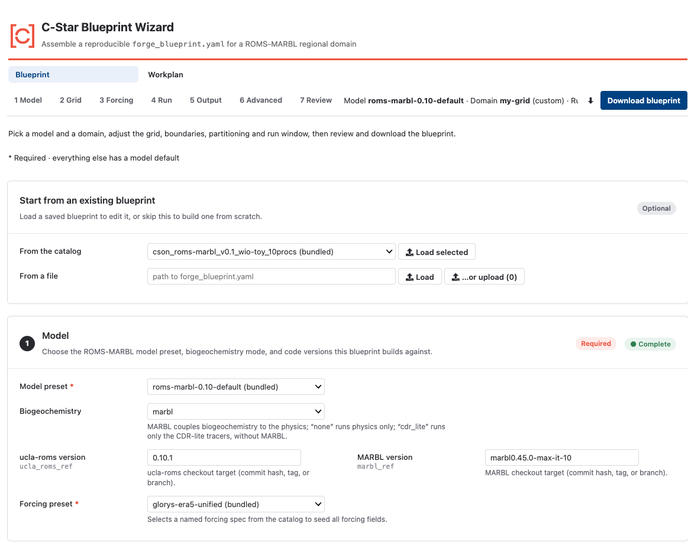
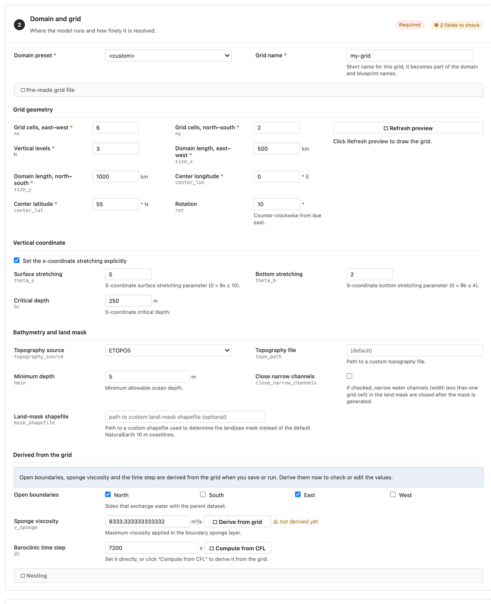
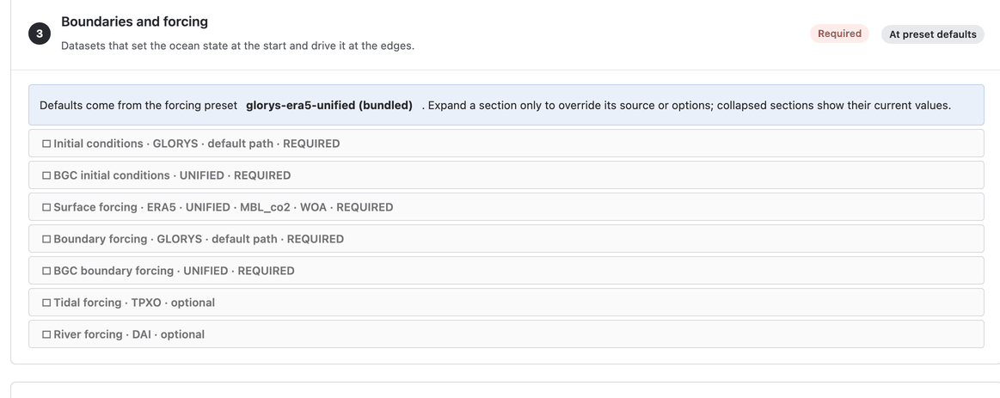
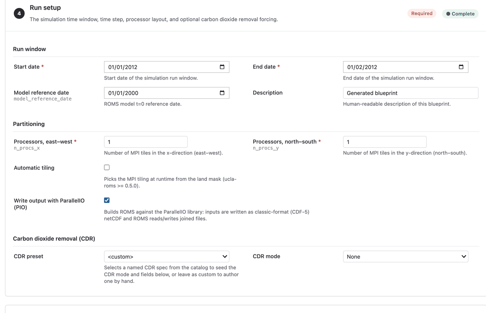
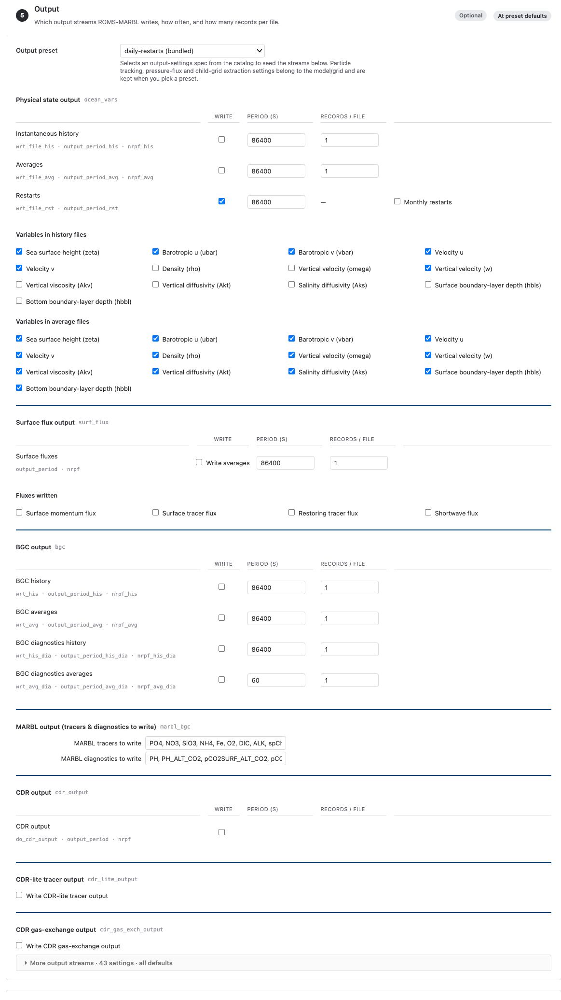
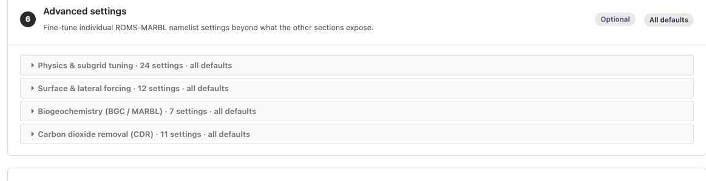
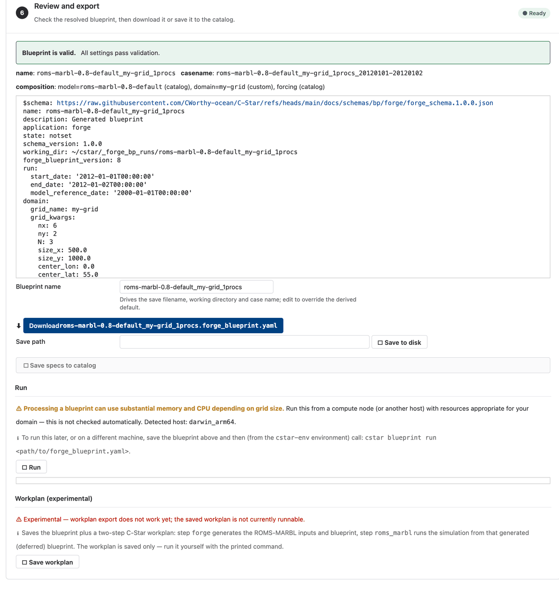

.. _wizard-blueprints:

Creating forge blueprints with the wizard
=========================================

The wizard's Blueprint page builds a :doc:`forge blueprint
<../applications/forge/blueprint>` without writing YAML. It presents the
choices as a series of sections, fills each from the catalog, shows the
resolved blueprint for review, and saves or downloads it. The wizard only
writes the blueprint; nothing is downloaded or generated until you run it.
:doc:`launching` covers how to start the wizard, and :doc:`workplans` the
page that composes blueprints into a workplan.

The sections
------------

The sections are worked top to bottom. Required sections are marked; the rest
can be left at their defaults.

Start from an existing blueprint
   Load a blueprint saved in your catalog, or paste YAML, to edit it. Skip
   this section to build one from scratch.

Model
   The model preset (a **ModelSpec** from the catalog), which pins the ROMS,
   MARBL and PIO code versions and the model-level default settings; the
   biogeochemistry mode (MARBL, physics only, or CDR-lite without MARBL);
   and whether to build with ParallelIO.

   The ``cdr_lite`` mode (ucla-roms 0.10.0 or later) builds ucla-roms' CDR-lite
   tracers without MARBL, so the blueprint carries no biogeochemical forcing.
   It needs a CDR forcing: the CDR panel in Run setup shows a reminder, and a
   simple-mode forcing then builds one ALK (OAE) release, while a YAML or
   netCDF forcing must use ``tracer_set: cdr_lite``. The mode also reads the
   carbonate sensitivities (``ddic_dco2`` and ``ddic_dalk``) from files, so a
   **Carbonate sensitivities** group appears below the mode. By default it is
   left to the ``carbonate-sensitivity-from`` workplan directive, which
   supplies the ``_cdrgas`` output of an earlier UCLA-ROMS step with MARBL when the
   workplan runs. Choose *Directory of ROMS _cdrgas files* instead to attach
   the files now: the wizard lists the joined files in the directory (the
   per-rank tiles are skipped), checks they are netCDF, hashes them and records
   them on the blueprint. With ParallelIO on, Forge converts any file that is
   not classic netCDF to CDF-5 when it stages the copies.

Domain and grid
   Where the model runs and how finely it is resolved. Pick a **DomainSpec**
   from the catalog or edit the grid geometry (extent, resolution, rotation),
   the vertical coordinate, and the bathymetry source and land mask. You can
   attach a pre-made grid file instead of generating one. Open boundaries,
   the sponge viscosity and the time step are derived from the grid unless
   you override them, and an optional nesting section relates this grid to a
   parent or child domain.

Boundaries and forcing
   The datasets that set the ocean state at the start and drive it at the
   edges: a **ForcingSpec** from the catalog, or your own selection of
   initial-condition, surface, boundary, tidal and river sources, with
   biogeochemical sources and the interpolation method for each. Sources
   that you must download yourself (TPXO tides, for example) are noted here;
   see :doc:`../getting_started/data_access`.

Run setup
   The run window (start, end and model reference date), the processor
   layout and PIO or automatic-tiling options, and optional carbon dioxide
   removal forcing, imported from a netCDF file or described by hand (required
   in ``cdr_lite`` mode).

Output
   What the model writes. An **OutputSpec** from the catalog, picked at the
   top, seeds the output streams below it, and every stream stays editable.
   Picking a preset replaces your edits to the streams it owns; particle
   tracking, the pressure-flux calculation and child-grid extraction belong to
   the model and the grid, so your edits to those are kept.
   The main streams are always shown, each under its own heading: the
   physical state (history, averages and restarts), surface fluxes, the
   biogeochemistry output controls, and the CDR streams. The biogeochemistry
   and CDR streams are shown only in the modes that produce them: all of them
   with MARBL, and only the CDR-lite tracer output in ``cdr_lite`` mode. The
   less common streams (diagnostics, temperature and salinity, forcing fields,
   depth slices, random output, particle tracking, the pressure-flux
   calculation and runtime diagnostics) are collected in a collapsed **More
   output streams** group.

   Two streams depend on nesting. **Child-grid boundary extraction**
   (``extract_data``) appears only while *This grid is a parent* is on in the
   Grid section; there only the records per file and the extraction root name
   are edited here, while the child grid, extraction period and file come from
   the nesting options. **Upscaled output** (``upscale_output``) is a main
   stream while *This is a child grid* is on, because its ``_uscl`` files feed
   the parent's upscaled-CDR run (see **Upscale a nested run** on the
   :doc:`Workplan page <workplans>`), and otherwise sits under **More output streams**.

Advanced settings
   Individual UCLA-ROMS namelist settings beyond what the other sections
   expose, grouped by concern (physics and subgrid tuning, surface and lateral
   forcing, biogeochemistry, and CDR forcing), plus the compile-time switches.
   The output streams are in the Output section instead.

Review and export
   The resolved blueprint as YAML, with validation messages. From here you
   can **Download** the file, **Save** it to your catalog, save any spec you
   modified as a new named catalog entry, or run the blueprint through the
   C-Star command line. To run this blueprint as part of a workplan, build
   one on the Workplan page. **Run** executes ``cstar blueprint run`` on the
   machine the wizard is running on, so on a cluster's login node use it only
   for toy domains; for real domains save the blueprint and submit it with
   ``cstar blueprint submit`` (see :doc:`../applications/blueprints`).

What happens next
-----------------

Blueprints you save, and specs you register, land in your own writable
catalog layer, ``~/cstar/catalog`` by default (see :doc:`catalog`).
Process the blueprint with ``cstar blueprint run`` as described in
:doc:`../applications/forge/blueprint`, or add it to a workplan on the
:doc:`Workplan page <workplans>`.
