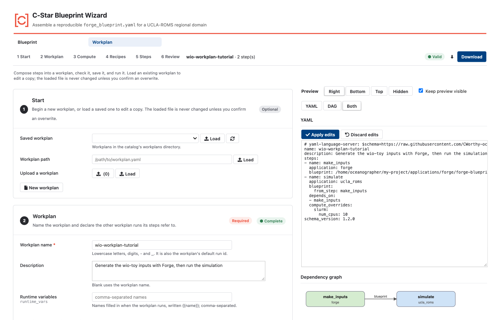
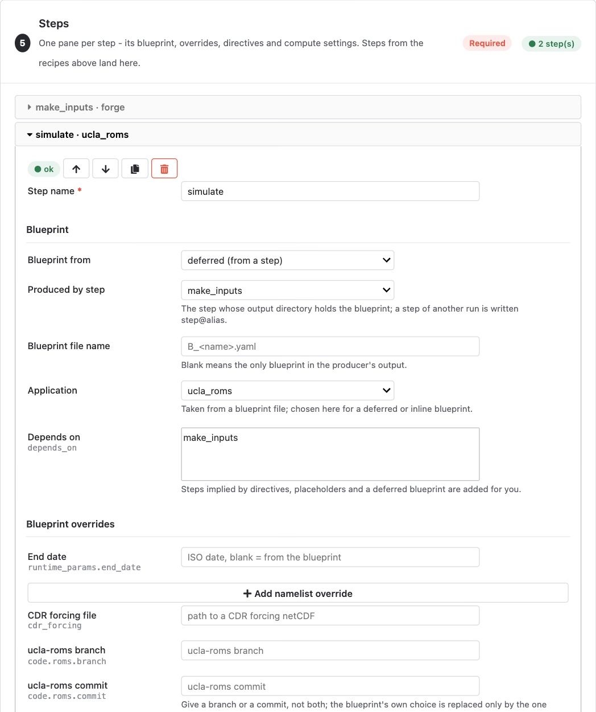
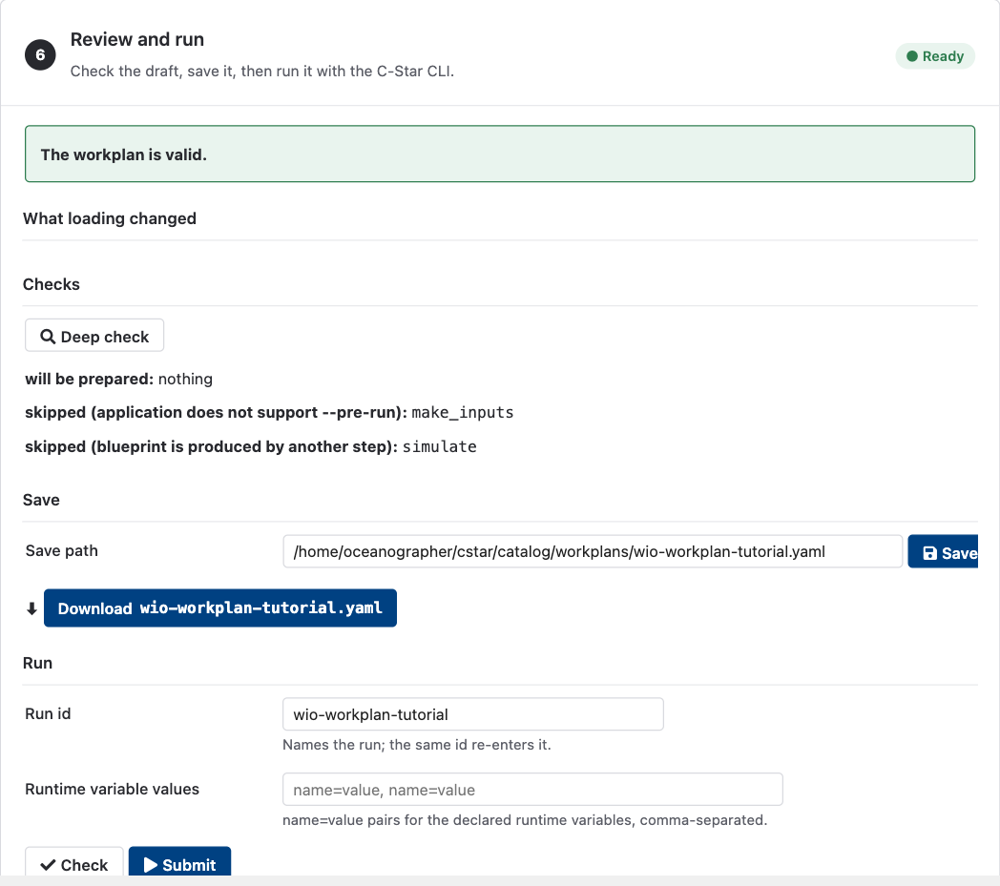

.. _wizard-workplans:

Creating workplans with the wizard
==================================

The wizard's Workplan page builds a :doc:`workplan <../workplans/index>` the
way the Blueprint page builds a blueprint: piece by piece, with the YAML and a
picture of the step graph updating as you go, and a check that runs after
every edit so that a problem is pointed out where you make it rather than
when you submit. It is a convenient way to put together the recurring shapes
of a modeling project, such as a Forge step feeding a simulation, a long run
split into chunks, or a nested run with upscaling, without remembering the
syntax of every directive.

.. note::

   The Workplan page is under active development. Its sections and recipes
   change between releases, and anything it writes can also be written by
   hand: the result is an ordinary workplan file that ``cstar workplan
   check`` and ``cstar workplan submit`` accept, and that you can keep
   editing in a text editor.

Open it with the **Workplan** tab at the top of the wizard (see
:doc:`launching`). A sticky bar under the tabs lists the sections, names
the draft and says whether it is valid.

   The Workplan page: sections on the left, the live YAML and dependency graph on the right.

The layout
----------

On a wide screen the page has two columns. The sections are on the left. On the
right, kept in view while you scroll, is a live picture of what you are
building, switchable between the **YAML**, the **DAG** (the steps drawn left
to right by dependency, coloured by application, with edges labelled by what
they carry: a restart, boundary data, carbonate sensitivities, a deferred
blueprint) and both. The YAML is editable: change it and press **Apply
edits** to load the text back into the sections. The **Preview** control moves
the pane to the bottom or top of the page, or hides it. On a narrow screen
the columns stack.

The sections
------------

Start
   Begin a new workplan, or load one to edit: from the catalog's
   ``workplans/`` directory, from a path, or by upload. The file you loaded
   is never written unless you confirm an overwrite when saving.

Workplan
   The name (which is also the run ID), a description, the runtime
   variables, and a table of **aliases to previous run-ids**: each row binds
   an alias to another run that this workplan refers to as ``step@alias``
   (see :doc:`../workplans/references`). **Refresh runs** lists the runs
   recorded on this machine, so a picked run offers its steps in every step
   picker and shows each step's status.

Compute
   Where the workplan runs: **Local**, **SLURM**, or **Not specified**, which
   leaves the choice to the machine it is submitted on. A SLURM target names
   the machine, its queue, the account and a default walltime, written to the
   workplan's ``compute_environment``. On a supported machine the page
   preselects it, and blank fields fall back to your ``CSTAR_SLURM_*``
   settings, shown in grey.

Recipes
   Generators for the recurring shapes. Each adds ordinary steps to the Steps
   section, which you can keep editing:

   - **Forge inputs, then run** adds a Forge step and the simulation step
     that runs the blueprint it generates.
   - **Chunk a run in time** splits a simulation into chained steps by
     calendar month, a fixed number of days, or equal parts, each continuing
     from the previous one's restart.
   - **Spin-up ramp** chains short segments with a growing time step.
   - **Upscale a nested run** is not yet supported. Build the upscaled rerun
     by hand, as in :doc:`../tutorials/nesting_upscaling`.

Steps
   One collapsible pane per step, with buttons to duplicate, delete and move
   it. A pane holds the blueprint (from the catalog, a path, an upload, the
   blueprint on the Blueprint page, a deferred blueprint from an upstream
   step, or an inline one), the steps it depends on (dependencies implied by
   a directive or a placeholder are added for you), the blueprint overrides,
   the directives for a UCLA-ROMS step (where it continues from, its boundary
   sources, its carbonate sensitivity sources), and the compute overrides.

   A step's pane.

Review
   Validation messages, the list of changes made on load, and the save,
   download, check and submit controls. **Save** writes the draft to the
   catalog's ``workplans/`` directory. **Deep check** resolves the draft as
   submitting it would, listing every problem. **Check** and **Submit** run
   ``cstar workplan check`` and ``cstar workplan submit`` and stream their
   output into the page; on a SLURM target, **Pre-run first** prepares the
   steps that can be prepared on this machine before the run is submitted
   (see :doc:`../runs/pre_run_resume`). After a submit, the page names the
   ``cstar run status`` command to follow the run with.

   The Review section.

Where the workplan goes
-----------------------

A saved workplan lands in your writable catalog layer, under ``workplans/``
in ``~/cstar/catalog`` by default (see :doc:`catalog`), and the download
link gives you the same file to keep next to your blueprints. From there it
is an ordinary workplan: submit it from the page, or with ``cstar workplan
submit`` from the command line, and follow it as described in
:doc:`../runs/monitoring`.
