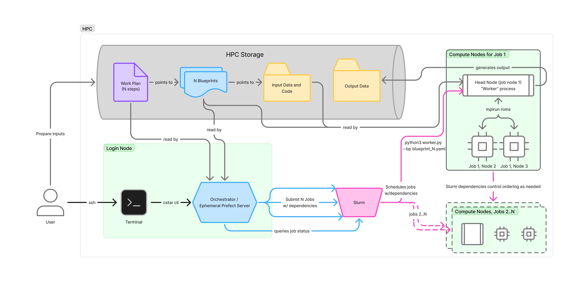

.. _hpc:

Working on HPC systems
======================

C-Star runs on a laptop with no special setup. On a cluster a few things
differ: the scheduler must be configured, data goes on the right file
system, and Python environments need protecting from the module system.
:doc:`machines` lists the systems C-Star has been tested on.

This diagram shows a user-initiated workflow on an HPC system. The user has
already prepared a workplan and its blueprints, with the input data on the
cluster's storage (for example by running Forge there first).

The user logs in to a login node and starts the workplan with the ``cstar``
command line. This creates an orchestrator that reads the workplan, works
out which steps can run, prepares each step's blueprint, and submits the
steps to SLURM. SLURM allocates compute resources, enforces the dependencies,
and monitors the jobs. Each step gets its own allocation, in which a worker
reads the step's blueprint and runs the application.

The user can log off and come back later. Calling ``cstar run status``
with the same run ID reports how far the workplan has progressed.

Configure the scheduler
-----------------------

C-Star needs to know which account and queue to submit jobs to. Run
``cstar init`` once on the cluster: it lists your SLURM accounts and
partitions, asks for the account, queue and default walltime, and writes
them to your :doc:`configuration file <../getting_started/configuration>`:

.. code-block:: bash

   CSTAR_SLURM_ACCOUNT=my-allocation      # the account or allocation jobs are charged to
   CSTAR_SLURM_QUEUE=mpi                  # the partition or queue to submit to
   CSTAR_SLURM_MAX_WALLTIME=01:00:00      # default time requested per job

What each system needs:

- **Anvil, Bouchet**: the account and the queue are both required.
- **Elja**: no account is used; an unset queue submits to ``any_cpu``.
- **Expanse**: the account is required; an unset queue submits to ``compute``.
- **Perlmutter**: an unset account charges your default NERSC project; an
  unset queue submits to the ``regular`` QOS.

Set the walltime to fit your queue: left unset, a job asks for 48 hours,
which is more than some queues allow. These settings are the defaults for
every step of a workplan, and a step can ask for different resources (see
:ref:`workplan_compute_environment`).

Run work on the compute nodes
-----------------------------

Submit your work as a :doc:`workplan <../workplans/index>`. ``cstar workplan
submit`` sends each step to SLURM and returns, so every stage runs on a
compute node and you can log off. For one blueprint, ``cstar blueprint
submit my_blueprint.yaml`` does the same with a single-step workplan (see
:doc:`../applications/blueprints`).

``cstar blueprint run`` instead runs everything on the node you start it
from, so use it inside an allocation (``salloc``, or your own batch script).
UCLA-ROMS will not start the model on a login node unless you set
``CSTAR_ALLOW_LOGIN_NODE_RUN=1``, which is only for runs small enough for
one.

To catch start-up problems before waiting in the queue, prepare the run on
the login node first with ``--pre-run``; see :doc:`../runs/pre_run_resume`.

Where data goes
---------------

On a cluster, C-Star keeps data in three places. ``cstar env show`` prints
``CSTAR_DATA_HOME``, and ``cstar forge show-paths`` prints the source-data
cache and the project runs area for the machine you are on.

Run output
   Everything a blueprint or workplan writes goes under ``CSTAR_DATA_HOME``.
   On a supported HPC system that is a ``cstar`` directory on your scratch
   file system (``$SCRATCH``, or the system's equivalent); on a laptop it is
   ``~/cstar``. Scratch is fast and large, but it is usually purged on a
   schedule, so move results you want to keep (see below).
Source-data cache
   The datasets Forge downloads or you stage by hand (GLORYS, TPXO and so
   on), shared by every domain you build, in ``cstar/source-data`` under
   ``CSTAR_PROJECT_HOME``. That defaults to ``$PROJECT``, so on Anvil it is
   ``$PROJECT/cstar/source-data``; without a project directory it falls back
   to scratch, then to your home directory. Point ``CSTAR_PROJECT_HOME`` at a
   group directory to share one cache with your collaborators.
Project runs area
   ``cstar/runs`` under the same ``CSTAR_PROJECT_HOME``: a shared place for
   finished runs that should outlast scratch. ``cstar run promote`` puts a
   run there; see :doc:`../runs/moving/promote`.

Some systems define ``PROJECT`` and ``SCRATCH`` for you (Anvil exports both,
Perlmutter exports ``SCRATCH``). Check with ``echo $PROJECT $SCRATCH``, and
set them in your shell profile only if they are empty.

Keep the environment off ``~/.local``
--------------------------------------

On clusters, Python's user-site directory (``~/.local/lib/pythonX.Y``) is a
common cause of environments that break without explanation: a
module-provided Python of the same minor version shares it, and packages
installed there shadow the environment's. If you see
``ModuleNotFoundError`` for a package you know is installed, or pip installs
that vanish, set:

.. code-block:: console

   export PYTHONNOUSERSITE=1

in your shell profile, or in the environment's ``activate.d`` so it applies
whenever the environment is active.

Notebooks and the wizard
------------------------

If your cluster offers a hosted Jupyter, such as an OnDemand portal, run
``cstar env register-kernel`` once so notebooks, the wizard notebook
included, can use your C-Star environment. To use the wizard as a web page
instead, serve it on the login node and forward its port from your laptop;
see :doc:`../catalog_wizard/launching`.
