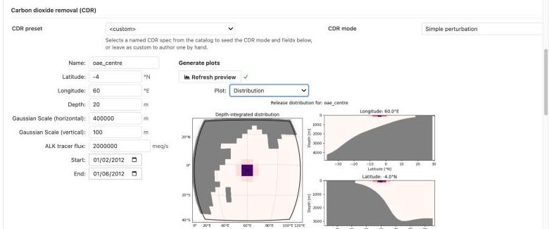
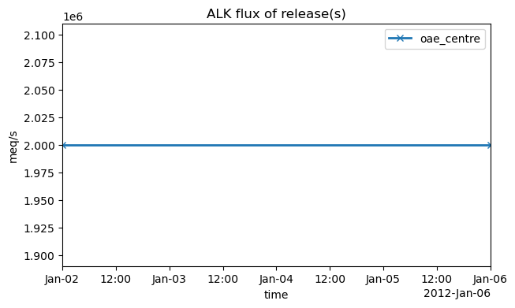
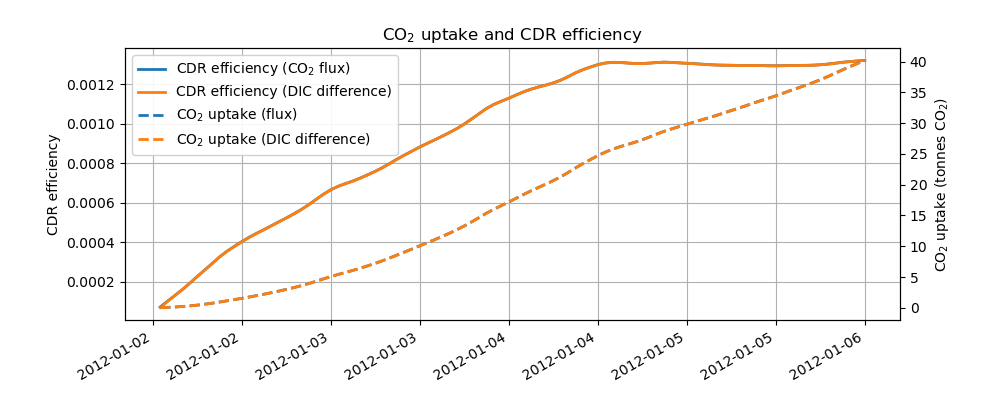

.. _tutorial-cdr-workplan:

Spin-up, a CDR release and its metrics
======================================

This page puts the pieces of a small carbon dioxide removal (CDR) experiment
into one workplan: generate the inputs, spin the domain up, continue it with
an alkalinity release switched on, and compute the release's CO2 uptake and
CDR efficiency. Five steps, one command. Along the way it introduces the two
ways steps influence each other beyond ordering: a step can **override**
values in its blueprint, and it can take files written by an earlier step
through a **directive**.

The grid is the ``wio-toy`` domain from the previous pages (20 by 20 cells,
400 km each, 8000 km across). The whole workplan takes about ten minutes on a
recent laptop once the source data and the model code are cached, and longer
the first time, while they download.

Before you start
----------------

Download the three files into an empty directory:

- :download:`workplan_cdr.yaml <workplan_cdr.yaml>`
- :download:`forge_blueprint_wio_spinup.yaml <forge_blueprint_wio_spinup.yaml>`
- :download:`forge_blueprint_wio_release.yaml <forge_blueprint_wio_release.yaml>`

The forge blueprints are ready-made. They use the same GLORYS, ERA5 and
biogeochemistry sources as the previous pages, with tides and rivers turned
off, so there is nothing further to register for or download. If you have run
the previous pages, the biogeochemistry climatology is already cached; GLORYS
is fetched again for the longer window, a few hundred megabytes.

The release
-----------

The two forge blueprints describe the same domain, forcing and output. They
differ in the run window (``wio-spinup`` covers 2012-01-01, ``wio-release``
the four days after it) and in one section, ``cdr``: the spin-up has none,
and the release blueprint adds one alkalinity release.

In the wizard this is the *Carbon dioxide removal* part of the *Run setup*
section. Setting the CDR mode to **Simple perturbation** opens a short form
for a single release: a name, where it is (latitude, longitude and depth),
how far it spreads (a Gaussian scale in the horizontal and the vertical), the
alkalinity flux, and the dates it is on. The wizard seeds the location with
the grid centre and the dates with the run window, which is what this
blueprint uses; the flux is the wizard's default. The horizontal scale is set
to 400 km, one grid cell, so that the release covers a few cells rather than
a point.

   The release as the wizard shows it: the form on the left, and on the right
   the *Distribution* plot from **Refresh preview**.

**Refresh preview** builds the forcing with roms-tools and draws it. *Release
locations* marks the release on a map of the grid. *Distribution* shows how
the alkalinity is spread: depth-integrated on the map, and in two vertical
sections through the release centre. *Tracer flux* plots the flux against
time, which for a simple release is a flat line over its dates.

   The *Tracer flux* plot: the release is on at the same rate for the whole
   run.

In the blueprint the form becomes a ``cdr`` section, which Forge hands to
roms-tools to write the CDR forcing file. ``times`` and ``tracer_fluxes``
describe the flux as a time series, so the form's single flux appears twice,
at the start and at the end:

.. literalinclude:: forge_blueprint_wio_release.yaml
   :language: yaml
   :start-at: cdr:
   :end-before: datasets:

A simple release is held at one rate for its whole window, and the window has
to cover the run: ROMS stops when the model time passes the last record of a
forcing file, so a release that ends early would end the run with it. For
anything beyond that, build the forcing with roms-tools directly: a pulse that
stops before the run does, several releases, a flux that varies in time, a
volume release of seawater with modified tracers, or a release of other
tracers. The `roms-tools CDR forcing documentation
<https://roms-tools.readthedocs.io/en/latest/cdr_forcing.html>`__ walks
through all of these. Then bring the result into the same CDR panel with the
two import modes: **Import ROMS-tools YAML** takes the ``to_yaml()`` dump of
the forcing, and Forge generates the file from it alongside the other inputs;
**Import netCDF** takes a forcing file you have already written with
``save()``, and Forge stages it as it is. Either way the forge blueprint
carries the forcing, and the rest of this page is unchanged.

The workplan
------------

.. literalinclude:: workplan_cdr.yaml
   :language: yaml

**make_spinup** and **make_release** are Forge runs. Each of the three steps
after them adds one idea.

**spinup** runs day one, and shows **blueprint overrides**. Its blueprint is
the one ``make_spinup`` writes, but ``blueprint_overrides`` changes one value
in it before the model runs: the time step is halved, to resolve the
adjustment from the reanalysis initial state more carefully. The override
keys follow the UCLA-ROMS blueprint: ``namelist_overrides`` is keyed by
namelist group and setting, and ``runtime_params`` would hold the run window
(see :doc:`../blueprints/ucla_roms`). The blueprint itself is not edited;
the overrides are applied to a copy when the step starts, and that copy is
kept in the step's ``work`` directory. The spin-up leaves behind a restart
file at the end of 2012-01-01.

**release** runs days two to five with the release on, and shows the
**continue-from** directive. A directive is an instruction that runs just
before the model starts, using something that only exists by then.
``continue-from: step: spinup`` looks in the spin-up's output for its latest
restart file, makes it this step's initial conditions, and sets the start
date to the restart's time. The initial conditions Forge generated for
``wio-release`` are not used; the end date stays as the blueprint has it, so
this run covers 2012-01-02 to 2012-01-06. The step lists both
``make_release`` (it reads that step's blueprint) and ``spinup`` (it reads
that step's restart) under ``depends_on``. Because its blueprint has a CDR
forcing, Forge built it with CDR forcing compiled in and the ``cdr_output``
stream on, so besides the usual history and restart files this run writes
``*_cdr.*.nc``: hourly averages of the release and of what it changes.

**metrics** is the one step here that is not ROMS or Forge. The
``cdr_metrics`` application reads the ``_cdr`` output of a run and computes
the release's CO2 uptake and CDR efficiency, with roms-tools. Its blueprint
is a grid file and the output to read, both of which are produced within this
workplan, so instead of writing a blueprint file that would immediately need
new paths, the step says ``blueprint: inline`` and gives them as overrides.
Each path uses a placeholder for another step's directory:
``{{root_dir: make_release}}`` is the Forge step's directory (its
``input_data/`` holds the grid it wrote), and ``{{output_dir: release}}`` is
the release run's output. Placeholders are filled in when the workplan is
submitted, which is why the step depends on both steps it points into.
:doc:`../blueprints/cdr_metrics` describes the application.

Run it
------

.. code-block:: console

   cstar workplan check workplan_cdr.yaml
   cstar workplan submit workplan_cdr.yaml

Then follow it as on the :doc:`previous page <workplan>`:

.. code-block:: console

   cstar run status wio-cdr-tutorial
   cstar run log wio-cdr-tutorial release --monitor

Each ROMS step fetches and compiles the model in its own directory (the two
builds differ, since only one has CDR forcing compiled in), so expect a
minute or two of compiling before each one starts stepping, and about as long
again for the simulation itself. If a step fails, the steps after it are not
run, and ``cstar run log wio-cdr-tutorial <step>`` has the reason. Fix the
cause and submit the workplan again; finished steps are kept and the failed
one is retried.

What to look at
---------------

When ``cstar run status`` shows every step as *Done*:

- ``spinup``'s output has a day of hourly history and a restart file at the
  end of its day.
- ``release``'s output has four days of history, a restart file at the end
  of each day, and four ``*_cdr.*.nc`` files, one per day. In them
  ``ALK_source`` is the release, and the pairs ``hDIC`` and
  ``hDIC_ALT_CO2``, ``FG_CO2`` and ``FG_ALT_CO2`` are the dissolved inorganic
  carbon and the air-sea CO2 flux with and without the release.
- ``release``'s ``work`` directory holds a copy of its blueprint after the
  directive was applied, ``B_wio-release.ovrd.cfrom.yaml``. Its
  ``initial_conditions`` points into ``spinup``'s output, and its ``runtime_params.start_date`` is the restart's time.
  Compare it with the blueprint in ``make_release``'s output to see exactly
  what the directive changed.
- ``metrics``'s output is the result: ``cdr_metrics.nc``, time series of the
  CO2 uptake in tonnes and of the CDR efficiency, each computed from the
  CO2 flux and from the DIC difference, and ``cdr_metrics.png``, a plot of
  them.

   ``cdr_metrics.png`` from the reference run.

The **uptake** is the extra CO2 the ocean has taken from the atmosphere
because of the release: the air-sea flux with the release minus the flux
without it, summed over the domain and over time. The **efficiency** divides
it by the alkalinity released so far, in CO2 equivalents, so it is the
fraction of the release's potential that has been realised. The uptake keeps
rising while the release is on. The efficiency climbs for the first two days,
while the alkalinity already in the water catches up with the air, and then
levels off, once the extra uptake grows as fast as the release. The
DIC-difference curves count the same perturbation from the water column
instead of the surface, and lie on top of the flux curves here. At the end of the run (2012-01-06 00:00), a
reference run with ucla-roms 0.11.0 and roms-tools 5.2.1 gave these values
(rounded):

.. list-table::
   :header-rows: 1
   :widths: 60 20 20

   * - Quantity
     - From the flux
     - From the DIC difference
   * - CO2 uptake (tonnes)
     - 40.2
     - 40.2
   * - CDR efficiency
     - 0.0013
     - 0.0013

Your numbers should be close to these but need not match them exactly: they
depend on the ucla-roms and roms-tools versions and on the compiler. On a
grid this coarse, with a release this short, the efficiency is far below what
a real experiment reaches over months; the point here is the workflow.

``cstar run show wio-cdr-tutorial`` lists all five steps with their timings,
and ``cstar run gather wio-cdr-tutorial`` links every step's output files
into one ``gathered_output`` directory under the run, if you prefer to browse
them in one place.

Where to go from here
---------------------

This is the skeleton of most CDR experiments built with C-Star: a spin-up,
a run with the perturbation, and the metrics, all described in one file that
someone else can re-run. The same tools stretch further than this page
shows. A ``continue-from`` can name a step of an *earlier* run instead of one
in the same workplan, so a long spin-up is done once and reused
(:ref:`workplan_external_runs`). Long runs are usually split into chunks that
each continue from the previous one, and the wizard's Workplan page has a
generator for that; the metrics step takes every chunk's output in order
(:doc:`../blueprints/cdr_metrics`). A release is best resolved on a fine grid
nested inside a coarser one, with its effect passed back up to the parent:
:doc:`nesting_upscaling` walks through that chain, ending with the CDR metrics
of both grids. :doc:`../workplans` and :doc:`../workplans/directives`
describe every option.
