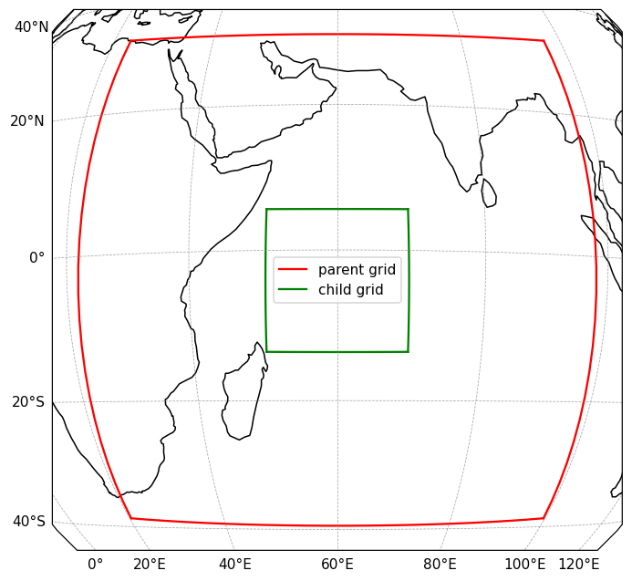
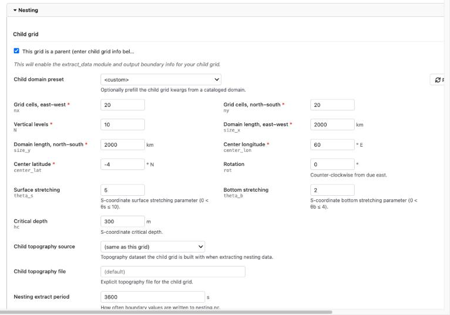

.. _tutorial-nested-workplan:

Spin-up, continuation and a nested grid
=======================================

This page puts the pieces of a typical regional modeling project into one
workplan: generate the inputs for two grids, spin the outer grid up, continue
it for the period of interest, and run a finer grid nested inside it over that
period. Six steps, one command. Along the way it introduces the two ways steps
influence each other beyond ordering: a step can **override** values in its
blueprint, and it can take files written by an earlier step through a
**directive**.

The grids are the ``wio-toy`` domain from the previous pages (20 by 20 cells,
400 km each, 8000 km across) and a child grid with the same number of cells
covering the central 2000 km of it, so each child cell is 100 km. The whole
workplan takes around a quarter of an hour on a recent laptop.

Before you start
----------------

Download the three files into an empty directory:

- :download:`workplan_nested.yaml <workplan_nested.yaml>`
- :download:`forge_blueprint_wio_outer.yaml <forge_blueprint_wio_outer.yaml>`
- :download:`forge_blueprint_wio_inner.yaml <forge_blueprint_wio_inner.yaml>`

The forge blueprints are ready-made. They use the same GLORYS, ERA5 and
biogeochemistry sources as the previous pages, with tides and rivers turned
off so there is nothing further to register for or download. If you have run
the previous pages, the GLORYS data for the outer grid is already cached; the
inner grid fetches its own, smaller cut.

The two grids
-------------

   The outer grid and, inside it, the inner grid.

Nesting is set up in Forge, before anything runs, and the two grids have to
know about each other. The outer domain needs to know where the inner grid's
edges are, so that its run writes out the boundary values the inner run will
read, at every hour. The inner domain needs to know the outer grid, so that
its land mask and bathymetry are smoothed to match the outer grid's along its
edges, where the two have to agree. That is why the inner blueprint has no
boundary forcing of its own: its boundaries come from the outer run, not from
a reanalysis. Both blueprints are otherwise ordinary.

In the wizard, this is the nesting part of the *Domain and grid* section: tick
*This grid is a parent* on the outer domain and enter the inner grid, or
*This is a child grid* on the inner one and enter the outer grid.

The run windows differ on purpose: the outer blueprint covers 2012-01-01 to
2012-01-03, the inner one only the second day.

The workplan
------------

.. literalinclude:: workplan_nested.yaml
   :language: yaml

The first two steps are Forge runs with nothing to wait for, so they run at
the same time. Each of the four steps after them adds one idea.

**spinup** runs day one of the outer grid, and shows **blueprint overrides**.
Its blueprint is the one ``make_outer`` writes, but ``blueprint_overrides``
changes two values in it before the model runs: the end date is pulled back
by a day, and the time step is halved, to resolve the adjustment from the
reanalysis initial state more carefully. The override keys follow the
ROMS-MARBL blueprint:
``runtime_params`` is the run window, and ``namelist_overrides`` is keyed by
namelist group and setting (see :doc:`../blueprints/roms_marbl`). The
blueprint itself is not edited; the overrides are applied to a copy when the
step starts, and that copy is kept in the step's ``work`` directory. The
spin-up leaves behind a restart file at the end of 2012-01-01 and, because
the boundary extraction is turned on (in the namelist, as specified by the
forge blueprint, since we know this is a "parent" domain), a day of hourly
boundary values for the child is also generated.

**outer** runs day two of the outer grid, and shows the **continue-from**
directive. A directive is an instruction that runs just before the model
starts, using something that only exists by then. ``continue-from: step:
spinup`` looks in the spin-up's output for its latest restart file, makes it
this step's initial conditions, and sets the start date to the restart's time.
The end date stays as the blueprint has it, so this run covers 2012-01-02 to
2012-01-03. The step lists both ``make_outer`` (it reads that step's blueprint)
and ``spinup`` (it reads that step's restart) under ``depends_on``.

**inner_ic** is the one step here that is not ROMS or Forge. The inner grid
cannot start from a GLORYS initial conditions file from Forge, because it
would not match the outer run it is nested in. The small ``nest_ic``
application interpolates a parent restart file onto the child grid. Its
blueprint is three paths, all of which get generated within this workplan, so
instead of writing a blueprint file that will immediately need to be overridden with
new paths, the step says ``blueprint: inline`` and gives the paths as dynamic overrides.
Each path uses a placeholder for another step's directory: ``{{root_dir: make_outer}}`` is the outer Forge
step's directory (its ``input_data/`` holds the grid it wrote),
``{{output_dir: spinup}}`` is the spin-up's output, where ROMS put the restart
file for the end of day one. Placeholders are filled in when the workplan is
submitted, which is why the step depends on all three steps it points into.

**inner** runs the child grid over day two, with two directives. ``continue-from:
step: inner_ic`` picks up the initial-conditions file ``inner_ic`` wrote, since
it is named like a restart. ``nest-from: step: spinup;outer`` collects the
hourly boundary files both outer-grid runs extracted (``child_bry.<time>.nc``
in their outputs) and makes them this step's boundary forcing. Two sources,
separated by ``;``, because ROMS needs boundary values on both sides of every
time it steps through, including the first one: the spin-up's last record is
at 2012-01-02 00:00, exactly where the inner run starts, and the outer run's
first is an hour later.

Run it
------

.. code-block:: console

   cstar workplan check workplan_nested.yaml
   cstar workplan submit workplan_nested.yaml

Then follow it as on the :doc:`previous page <workplan>`:

.. code-block:: console

   cstar run status wio-nested-tutorial
   cstar run log wio-nested-tutorial outer --monitor

Each ROMS step fetches and compiles the model in its own directory, so
expect a minute or two of compiling before each one starts stepping, and
about as long again for the simulation itself. If a step fails, the steps
after it are not run, and ``cstar run log wio-nested-tutorial <step>`` has the reason.
Fix the cause and submit the workplan again; finished steps are kept and the
failed one is retried.

What to look at
---------------

When ``cstar run status`` shows every step as *Done*:

- ``spinup``'s and ``outer``'s outputs each have a day of history, a restart
  file at the end of their day, and one ``child_bry.*.nc`` extraction file.
- ``inner_ic``'s output has one file, the inner grid's initial conditions at
  2012-01-02 00:00.
- ``inner``'s ``work`` directory holds a copy of its blueprint after each
  directive was applied; the one with the longest name is what actually
  ran. Its ``initial_conditions`` points into ``inner_ic`` and its
  ``forcing.boundary`` lists the two outer-grid runs' extraction files. Compare it
  with the blueprint in ``make_inner``'s output to see exactly what the
  directives changed.
- ``cstar run show wio-nested-tutorial`` lists all six steps with their timings, and
  ``cstar run gather wio-nested-tutorial`` links every step's output files into one
  ``gathered_output`` directory under the run, if you prefer to browse them
  in one place.

Where to go from here
---------------------

This is the skeleton of most projects built with C-Star: a spin-up, a
production segment, and grids nested one inside the other, all described in
one file that someone else can re-run. The same tools stretch further than
this page shows. A ``continue-from`` can name a step of an *earlier* run
instead of one in the same workplan, so a long spin-up is done once and reused
(:ref:`workplan_external_runs`). Long runs are usually split into chunks that
each continue from the previous one, and the wizard's Workplan page has a
generator for that. Carbon dioxide removal experiments add a forcing file and
a control run alongside the experiment, and nested CDR runs can pass their
effect back up to the parent: :doc:`nesting_upscaling` walks through that
chain, ending with the CDR metrics of both grids. :doc:`../workplans` and
:doc:`../workplans/directives` describe every option.
